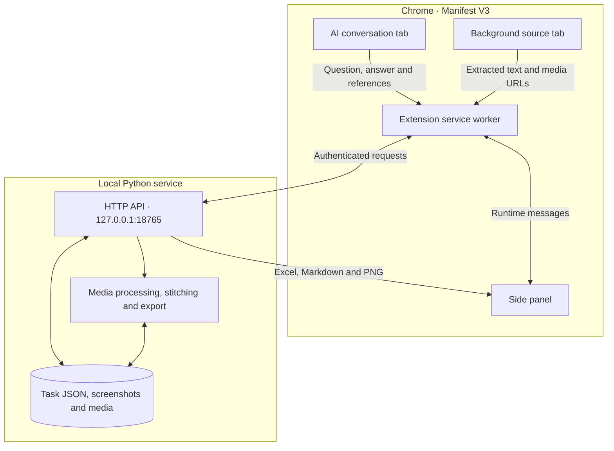

# 架构说明 / Architecture

[简体中文](#中文) · [English](#english) · [返回产品说明 / Product README](../README.md)



## 中文

### 运行组件

| 组件 | 职责 |
| --- | --- |
| [Chrome 清单](../extension/manifest.json)和[侧栏](../extension/panel.js) | Manifest V3 声明支持的 AI 平台、侧栏和权限。侧栏负责连接设置、任务切换、截图预览、顶部下载和导出。 |
| [页面采集](../extension/collector.js) | 按平台识别问答和引用区域，读取网页可访问的信源及语义搜索词。支持当前回答、手动选区和已加载对话。 |
| [扩展后台](../extension/background.js)和[信源提取](../extension/extractor.js) | 接收侧栏消息，调用本机 API。对原链接做[规范化与去重](../extension/core.js)，并使用后台标签页依次读取信源。 |
| [问答定位](../extension/answer-capture.js)和[截图](../extension/screenshot.js) | 锁定同一轮问答，用 Chrome 原生截图接口逐段截取、裁剪并检查截图完整性。 |
| [本机服务](../server/app.py) | 负责认证、任务存储、媒体处理、截图拼接和文件导出。Python 3.12 运行服务，Pillow 处理 PNG，openpyxl 生成 Excel，FFmpeg 处理音频。 |
| [服务启动器](../server/launcher.py) | Windows 和 macOS 启停脚本共用的入口。启动器结合健康检查、PID 和进程信息判断服务是否属于当前安装目录。 |

### 数据流

1. **导入**。侧栏把采集请求交给扩展后台。页面脚本读取选中范围的回答和引用。后台合并重复链接、保留原始 URL，再通过 `POST /tasks` 保存任务。页面标注的引用总数高于实际读到的数量时，任务会附带提示。
2. **按需补采**。用户主动补采时，后台在 Chrome 存储中维护待办队列和当前采集项。每次打开一个后台信源标签页，读取正文或发布文案，交给本机服务保存。仅在本次任务明确勾选时下载视频或图集。标签页超时或提取失败时记录原因。服务重启时，有已保存文件的中断项标为部分完成，其余中断项回到待处理状态。
3. **问答截图**。截图模块从本轮提问顶部开始滚动。每段用 `chrome.tabs.captureVisibleTab` 获取画面，再裁剪成问答区域。截图结束前再次检查标签页、页面和问答内容，成功后把完整分段发给 `POST /screenshots`。本机服务按页面和回答内容匹配任务，先在暂存目录拼接，再保存 PNG。长图可拆分，页面发生变化时取消本次保存。
4. **导出**。本机服务直接生成 XLSX 或 Markdown。Excel 为超长单元格生成续列，Markdown 保留长文本和截图链接。指定目录模式下，截图直接保存在选中的目录，文档归入任务子文件夹。同名的不同图片追加编号。截图使用任务对应的关键词、创建日期和平台命名，日期按 UTC+8 计算。

### 存储

```text
data/
  tasks/<task-id>/
    task.json                         # 问答、信源、状态、素材和截图索引
    <item-id>/                        # 该信源的正文、视频、图片等素材
    screenshots/<capture-id>/         # 一次截图的 PNG 文件
  capture-staging/                    # 拼接截图的临时目录
  trash/<task-id>/                    # 可恢复的任务
  diagnostics/                        # 本机诊断
  settings.json                       # 本机设置及已配置的 API 凭据
  pairing-token.txt                   # 本机连接码
```

任务 JSON 通过临时文件替换写入，列表按文件修改时间和大小缓存任务摘要。Chrome 存储保留连接码、当前任务和浏览器队列，任务数据与素材由本机服务保存。

### 本机 API 与权限

| 方法与路径 | 用途 |
| --- | --- |
| `GET /health` | 返回服务版本和支持的截图范围。 |
| `GET /tasks`、`POST /tasks`、`GET /tasks/{id}` | 列表、创建和读取任务。 |
| `POST /tasks/{id}/items/{itemId}/extract` | 保存补采结果。仅当本次传入 `downloadVideo: true` 时尝试下载视频或图集。 |
| `POST /screenshots` | 校验、拼接并保存完整问答截图。 |
| `GET /tasks/{id}/{format}` | 按 `xlsx` 或 `md` 格式生成下载文件。 |
| `GET /library`、`POST /library/{operation}` | 查看资料库，执行 `trash`、`restore` 或 `purge`。 |

服务只监听本机回环地址。数据接口检查本机 Host、请求来源和 `Authorization: Bearer <token>`。对信源和素材发起服务端下载时，检查 URL 与跳转地址是否指向公网。Chrome 的截图和跨站信源提取可能需要额外授权。导入和补采不执行内容分析或语音转写，旧版 API 设置不会触发调用。历史转写和分析仍可查看和导出。

### 开发与打包

安装 Python 依赖后可运行本机服务。开发检查需要 Node.js 22。两种系统的 Python 路径见下方命令区。打包脚本用允许清单收录程序、文档和测试，生成 Chrome 插件包、跨平台运行包、GitHub 源码包及 SHA-256 清单。

## English

### Components

| Component | Responsibility |
| --- | --- |
| [Chrome manifest](../extension/manifest.json) and [side panel](../extension/panel.js) | Manifest V3 declares the supported sites, side panel, and permissions. The panel handles pairing, task selection, screenshot preview, downloads, and exports. |
| [Page collector](../extension/collector.js) | Finds the Q&A and citation sections for each platform and reads accessible references and displayed search queries. Supports the current answer, a manual selection, or the loaded conversation. |
| [Extension worker](../extension/background.js) and [source extractor](../extension/extractor.js) | Handles panel messages and calls the local API. [Normalizes and deduplicates URLs](../extension/core.js), then extracts sources one at a time in background tabs. |
| [Q&A locator](../extension/answer-capture.js) and [capture module](../extension/screenshot.js) | Pins the chosen question and answer and uses Chrome's native capture API to capture, crop, and verify image segments. |
| [Local service](../server/app.py) | Authenticates requests and manages tasks, media, image stitching, and exports. Runs on Python 3.12 and uses Pillow for PNGs, openpyxl for Excel, and FFmpeg for audio processing. |
| [Service launcher](../server/launcher.py) | Shared entry point for Windows and macOS. Checks the health endpoint, saved PID, and process information to identify the service for the current installation. |

### Data flow

1. **Import.** The panel sends a collection request to the extension worker. The page collector reads the answer and citations within the selected scope. The worker merges duplicate links, preserves the original URLs, and saves a task with `POST /tasks`. A warning is recorded when the page advertises more citations than the collector finds.
2. **Collect optional source content.** When requested, the worker stores pending jobs and the active job in Chrome storage. It opens one background source tab at a time and sends the extracted article text or caption to the local service. It downloads videos and galleries only when selected for that run. Timeouts and extraction errors are recorded on the task. On service restart, interrupted items with saved files are marked partial and the others return to pending.
3. **Capture the Q&A.** The capture module scrolls from the top of the question, calls `chrome.tabs.captureVisibleTab`, and crops each image to the Q&A region. It checks the active tab, page, and question and answer text before submitting the complete set of segments to `POST /screenshots`. The service matches the task by page and answer content, stitches in a staging directory, and saves the PNGs. Long images may be split. A change to the page or Q&A cancels the capture.
4. **Export.** The service generates XLSX or Markdown directly. Excel splits oversized values into continuation columns. Markdown keeps the full text and screenshot links. When a custom destination is selected, screenshots go into the selected folder and documents go into per-task subfolders. Different screenshots with the same name receive numbered suffixes. Screenshot names use the task keyword, creation date in UTC+8, and platform.

### Storage

| Location | Contents |
| --- | --- |
| `data/tasks/<task-id>/task.json` | Q&A, cited sources, processing status, and media and screenshot indexes. |
| `data/tasks/<task-id>/<item-id>/` | Saved source files, such as text, video, and images. |
| `data/tasks/<task-id>/screenshots/<capture-id>/` | PNGs for one capture. |
| `data/capture-staging/` and `data/trash/<task-id>/` | Temporary capture files and recoverable tasks. |
| `data/diagnostics/`, `data/settings.json`, and `data/pairing-token.txt` | Local diagnostics, settings and configured API credentials, and the pairing token. |

Task JSON is written through temporary-file replacement. The task list caches summaries based on file modification time and size. Chrome storage holds the pairing token, selected task, and browser queue. The local service owns task data and media files.

### Local API and permissions

| Method and path | Purpose |
| --- | --- |
| `GET /health` | Returns the service version and supported capture scopes. |
| `GET /tasks`, `POST /tasks`, `GET /tasks/{id}` | Lists, creates, and retrieves tasks. |
| `POST /tasks/{id}/items/{itemId}/extract` | Saves extracted source content and attempts to download media only when sent `downloadVideo: true`. |
| `POST /screenshots` | Validates, stitches, and saves a complete capture. |
| `GET /tasks/{id}/{format}` | Generates an `xlsx` or `md` download. |
| `GET /library`, `POST /library/{operation}` | Inspects the library and performs `trash`, `restore`, or `purge`. |

The service listens on loopback. Data routes check the local Host, request origin, and `Authorization: Bearer <token>`. Server-side fetches check that source, media, and redirect URLs resolve to public addresses. Chrome may require additional permissions for screenshots and cross-site source extraction. Import and extraction do not run content analysis or transcription, even if API settings from a previous version exist. Previously saved analysis and transcripts remain available for review and export.

### Development and packaging

Install the Python dependencies to run the service. Use Node.js 22 for the extension checks. The commands below show the Python paths for both operating systems. The packaging script selects program, documentation, and test files to build the Chrome-only ZIP, cross-platform runtime ZIP, GitHub source ZIP, and SHA-256 manifest.

## 开发命令 / Development commands

```sh
node scripts/check.mjs
node --test tests/*.test.mjs
```

**Windows PowerShell**

```powershell
.\.venv\Scripts\python.exe tests/server_test.py
.\.venv\Scripts\python.exe scripts/package.py
```

**macOS Terminal**

```bash
.venv/bin/python tests/server_test.py
.venv/bin/python scripts/package.py
```
